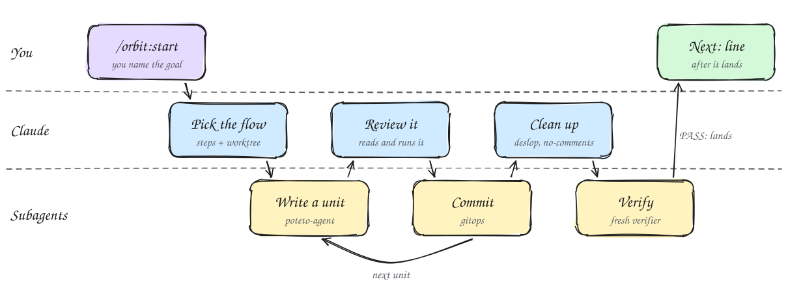

# orbit

**Claude Code on steroids.**

It plans, builds, tests and ships on its own. You just name the goal.

Orbit is mostly [pstack](https://github.com/cursor/plugins/tree/main/pstack) by Lauren Tan, trimmed and ported to Claude Code. [Differences from pstack](docs/pstack-differences.md) lists where orbit departs and why.

## Install

```
/plugin marketplace add aayushbtw/orbit
/plugin install orbit@orbit
```

Auto-update is off for third-party marketplaces. [Turn it on](docs/usage.md#auto-update) or run `claude plugin update orbit@orbit`.

## A task, start to finish

<picture>
  <source media="(prefers-color-scheme: dark)" srcset="docs/diagrams/readme-dark.svg">
  
</picture>

- A question stops after the answer, with citations.
- Large or cross-cutting work goes through `/orbit:figure-it-out`, which designs its own steps.
- Say "don't ship" to stop at the PR.

[Full walkthrough](docs/usage.md#a-task-start-to-finish). New to orbit? Read [the guide](docs/guide/README.md).

## What do I run?

| You want to | Run |
| --- | --- |
| Start a task or ask a question | `/orbit:start <goal>` |
| Get an open PR green | `/orbit:playbook babysit` |
| Land a ready change | `/orbit:ship` |
| Stop or switch model | `/orbit:pause-safely`, then `/orbit:session-pickup` in a new session |
| Learn how or why code works | `/orbit:how` or `/orbit:why` |
| Stop Claude repeating a mistake | `/orbit:correct` |

Every command: [docs/usage.md](docs/usage.md#every-command)

## The `Next:` line

Every task ends with one `Next:` line. Do what it says.

| Line | Means | You do |
| --- | --- | --- |
| `Next: nothing pending.` | Task is done | `/orbit:start` your next goal |
| `Next: /orbit:ship` | You said "don't ship", so the PR or unpushed branch waits | Run it to verify and land the change |
| `Next: /orbit:start <follow-up>` | Outside the goal or needs your decision. Claude says which. | Run it when ready |
| `Next: new session, then /orbit:session-pickup` | Work was paused | Open a new session, run it |

## Correct usage

- Give `/orbit:start` the goal, not the steps. Orbit picks the flow and the steps.
- Don't land a change by hand. A change task ships by default, and only after a fresh verifier passes it. Say "don't ship" or "I'll land it" to stop at the PR, or the unpushed branch under Land `main`, then land it with `/orbit:ship`.
- Project differences (check command, PR landing, extra review sources) go in the project's `## Workflow` block, not in chat.

## Make it fit a project

Defaults assume [Vite+](https://viteplus.dev), a worktree per change, and fast-forward onto `main`. If a project differs, list only what's different in its AGENTS.md:

```md
## Workflow

- Check: `vpr check`, plus `vpr e2e` when the UI changed.
- Land: `pr`
- Review also checks: `docs/architecture.md`.
```

More in [docs/usage.md](docs/usage.md):

- [Project defaults](docs/usage.md#project-defaults) and [folder rules](docs/usage.md#folder-rules)
- [Background agents](docs/usage.md#what-runs-in-the-background)
- [Principles](docs/usage.md#principles) and [stack rules](docs/usage.md#stack-rules)

## Maintain

- Develop without installing: `claude --plugin-dir ~/Projects/orbit/plugin`. Check with `claude plugin validate . && claude plugin validate plugin`.
- Vendored files are tracked in `skills.json`. Update them with `/update-skills [name]` from this repo.
- `/orbit:interrogate` may ask once to read the plugin folder for its review rubric. Allow `Read(~/.claude/plugins/**)` to skip the prompt.
- Release: bump `version` in `plugin/.claude-plugin/plugin.json`.
