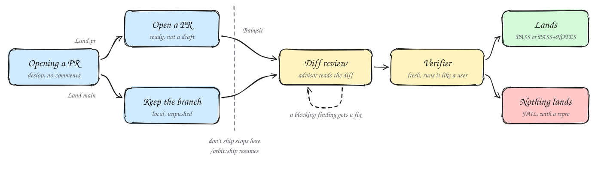

# orbit

Name the goal in T3 Code. Orbit plans, builds, verifies and ships it.

Orbit is mostly [pstack](https://github.com/cursor/plugins/tree/main/pstack) by Lauren Tan, trimmed and ported to Claude Code. [Differences from pstack](docs/pstack-differences.md) lists where orbit departs and why.

## Install

Send this in any T3 thread. The lead installs orbit for each provider it has a tested setup for and checks that it loads.

```
Set up orbit by following https://github.com/aayushbtw/orbit/blob/main/docs/setup.md
```

To install in Claude Code without T3, run:

```
/plugin marketplace add aayushbtw/orbit
/plugin install orbit@orbit
```

Auto-update is off for third-party marketplaces. [Turn it on](docs/usage.md#auto-update) or run `claude plugin update orbit@orbit`.

## A task, start to finish

<picture>
  <source media="(prefers-color-scheme: dark)" srcset="docs/diagrams/readme-dark.svg">
  
</picture>

- A question stops after the answer, with citations.
- Large or cross-cutting work goes through `/orbit:figure-it-out`, which designs its own steps.
- New to orbit? Read [the guide](docs/guide/README.md), which starts with the [full walkthrough](docs/guide/01-start-a-task.md).

## Run on any provider in T3

<picture>
  <source media="(prefers-color-scheme: dark)" srcset="docs/diagrams/t3-lead-dark.svg">
  
</picture>

A T3 thread led by Claude or another provider, such as Grok, runs orbit. Each review panel fills a second seat from your other T3 providers, so a second model family checks the work. [Orbit in T3 Code](plugin/docs/harness/t3-code.md) maps each step to T3's tools.

| Lead | Tested |
| --- | --- |
| Claude | Verified |
| Grok | Verified |
| Grok, code child on Claude | The wake after the child has not run live yet |
| Other providers | Untested |

To load orbit's rules in every session, even without `/orbit:start`, add this line to the provider's own instruction file, such as `~/.grok/AGENTS.md`. Setup adds it only when you say yes.

```
If Non-negotiables is not in your context, load the orbit `rules` skill before your first reply.
```

[How orbit runs in T3](docs/t3-code.md) covers how Grok loads and updates orbit.

## What do I run?

| You want to | Run |
| --- | --- |
| Start a task or ask a question | `/orbit:start <goal>` |
| Get an open PR green | `/orbit:playbook babysit` |
| Land a ready change | `/orbit:ship` |
| Stop or switch model | `/orbit:pause-safely`, then `/orbit:session-pickup` in a new session |
| Learn how or why code works | `/orbit:how` or `/orbit:why` |
| Stop a repeated mistake | `/orbit:correct` |

Every command: [docs/usage.md](docs/usage.md#every-command)

## The `Next:` line

Every task ends with one `Next:` line. Do what it says.

| Line | Means | You do |
| --- | --- | --- |
| `Next: nothing pending.` | Done | `/orbit:start` your next goal |
| `Next: /orbit:ship` | You said "don't ship" | Run it to verify and land |
| `Next: /orbit:start <follow-up>` | Outside the goal, or your call | Run it when ready |
| `Next: new session, then /orbit:session-pickup` | Work was paused | Run it in a new session |

## Ships by default

<picture>
  <source media="(prefers-color-scheme: dark)" srcset="docs/diagrams/guide-ship-dark.svg">
  
</picture>

Don't land a change by hand. Say "don't ship" or "I'll land it" to stop at the PR or unpushed branch, then land it with `/orbit:ship`.

## Make it fit a project

Defaults assume [Vite+](https://viteplus.dev), a worktree per change, and fast-forward onto `main`. List only what differs in the project's AGENTS.md, not in chat.

```md
## Workflow

- Check: `vpr check`, plus `vpr e2e` when the UI changed.
- Land: `pr`
- Review also checks: `docs/architecture.md`.
```

- [Project defaults](docs/usage.md#project-defaults) and [folder rules](docs/guide/08-make-it-fit.md#put-folder-rules-next-to-the-code)
- [Background agents](docs/usage.md#what-runs-in-the-background)
- [Principles](docs/usage.md#principles) and [stack rules](docs/guide/04-build-a-change.md#follow-the-stack-rules-for-typescript)

## Maintain

- Develop without installing with `claude --plugin-dir ~/Projects/orbit/plugin`.
- Check with `claude plugin validate . && claude plugin validate plugin`.
- Update vendored files, tracked in `skills.json`, with `/update-skills [name]` from this repo.
- `/orbit:interrogate` may ask once to read the plugin folder. Allow `Read(~/.claude/plugins/**)` to skip the prompt.
- To release, bump `version` in `plugin/.claude-plugin/plugin.json`.
