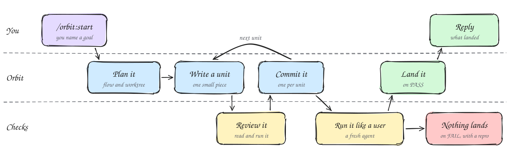

# orbit

Name the goal in T3 Code. Orbit plans, builds, verifies and ships it.

Orbit is mostly [pstack](https://github.com/cursor/plugins/tree/main/pstack) by Lauren Tan, trimmed and ported to Claude Code. [Differences from pstack](docs/pstack-differences.md) lists where orbit departs and why.

## Install

Orbit needs `git`, `gh` logged in with `gh auth login`, `node`, `bun` and `jq`. The default Check also needs [Vite+](https://viteplus.dev), unless the project's AGENTS.md names its own Check.

Install orbit once, in Claude Code:

```
/plugin marketplace add aayushbtw/orbit
/plugin install orbit@orbit
```

From a shell, run the same two steps with the `claude` command:

```
claude plugin marketplace add aayushbtw/orbit
claude plugin install orbit@orbit
```

Then run `/orbit:setup`, on any host. It reports each missing tool with its install command, checks the git repo and its Workflow block, compares the installed orbit with the marketplace copy, and checks what Codex and Grok load. When Codex is installed, setup offers to link it to the folder Claude Code installs orbit from, so Codex needs no install of its own. Setup asks once at the end before it changes anything.

The provider step runs only in a T3 thread. It lists your T3 providers, asks which ones fill each panel's seat on another family, and saves your choice for every project in `~/.claude/rules/orbit-models.md`. A project's AGENTS.md Models rows still win. The same providers run the verifier that checks each change before it lands. A second question asks whether orbit may run its native verifier when every listed provider fails, and recommends no. With no, the lead asks you before the native verifier runs, or holds the PR when no one can answer. Run setup from a Claude thread, because a Grok thread may load an older copy of orbit that lacks the skill.

Auto-update is off for third-party marketplaces. [Turn it on](docs/usage.md#auto-update) or run `claude plugin update orbit@orbit`.

## A task, start to finish

<picture>
  <source media="(prefers-color-scheme: dark)" srcset="docs/diagrams/readme-dark.svg">
  
</picture>

- A question stops after the answer, with citations.
- Large or cross-cutting work goes through `/orbit:figure-it-out`, which designs its own steps.
- New to orbit? Read [the guide](docs/guide/README.md), which starts with the [full walkthrough](docs/guide/01-start-a-task.md).

## Run on any provider in T3

<picture>
  <source media="(prefers-color-scheme: dark)" srcset="docs/diagrams/t3-lead-dark.svg">
  
</picture>

A T3 thread led by Claude or another provider, such as Codex or Grok, runs orbit. A review panel's seat on another family runs only on a provider you listed in `/orbit:setup`, never on one you left out. With no provider listed, the seat runs on the lead's family, and the reply says that no seat on another family is configured. When every listed provider fails, orbit skips the seat, and the reply says so. [Orbit in T3 Code](plugin/docs/harness/t3-code.md) maps each step to T3's tools.

| Lead in T3 | Live result |
| --- | --- |
| Claude | 16 of 16 scenarios pass, 1 run each. |
| Codex, code children on gpt-6.1-sol | 17 of 17 scenarios pass, 1 run each. The 5 that failed on the first run pass on a rerun after a fix. |
| Grok | Not proven. Each of 4 runs at `34fdaae` stopped on T3's usage-balance error before the lead acted. The native code child has never run live. |
| Other providers | Untested. |

[What is verified](docs/t3-code.md#what-is-verified) lists each scenario, its commit and its date.

To load orbit's rules in every session, even without `/orbit:start`, add this line to the provider's own instruction file, such as `~/.grok/AGENTS.md` or `~/.codex/AGENTS.md`. Setup adds it only when you say yes.

```
If Non-negotiables is not in your context, load the orbit `rules` skill before your first reply.
```

[How orbit runs in T3](docs/t3-code.md) covers how Grok and Codex load and update orbit.

## What do I run?

| You want to | Run |
| --- | --- |
| Start a task or ask a question | `/orbit:start <goal>` |
| Get an open PR green | `/orbit:playbook babysit` |
| Land a ready change | `/orbit:ship` |
| Stop or switch model | `/orbit:pause-safely`, then `/orbit:session-pickup` in a new session |
| Learn how or why code works | `/orbit:how` or `/orbit:why` |
| Stop a repeated mistake | `/orbit:correct` |

Every command: [docs/usage.md](docs/usage.md#every-command)

## The `Next:` line

Every task ends with one `Next:` line. Do what it says.

| Line | Means | You do |
| --- | --- | --- |
| `Next: nothing pending.` | Done | `/orbit:start` your next goal |
| `Next: /orbit:ship` | You said "don't ship" | Run it to verify and land |
| `Next: /orbit:start <follow-up>` | Outside the goal, or your call | Run it when ready |
| `Next: new session, then /orbit:session-pickup` | Work was paused | Run it in a new session |

## Ships by default

<picture>
  <source media="(prefers-color-scheme: dark)" srcset="docs/diagrams/guide-ship-dark.svg">
  
</picture>

Don't land a change by hand. Say "don't ship" or "I'll land it" to stop at the PR or unpushed branch, then land it with `/orbit:ship`.

## Make it fit a project

Defaults assume [Vite+](https://viteplus.dev), a worktree per change, and fast-forward onto `main`. List only what differs in the project's AGENTS.md, not in chat.

```md
## Workflow

- Check: `vpr check`, plus `vpr e2e` when the UI changed.
- Land: `pr`
- Review also checks: `docs/architecture.md`.
```

- [Project defaults](docs/usage.md#project-defaults) and [folder rules](docs/guide/08-make-it-fit.md#put-folder-rules-next-to-the-code)
- [Background agents](docs/usage.md#what-runs-in-the-background)
- [Principles](docs/usage.md#principles) and [stack rules](docs/guide/04-build-a-change.md#follow-the-stack-rules-for-typescript)

## Maintain

- Develop without installing with `claude --plugin-dir ~/Projects/orbit/plugin`.
- Check with the Check line in AGENTS.md. On every push, CI runs the Check and the hook, worktree audit, diagram drift, link, T3 grader and version tests in `tests/`.
- Update vendored files, tracked in `skills.json`, with `/update-skills [name]` from this repo.
- `/orbit:interrogate` may ask once to read the plugin folder. Allow `Read(~/.claude/plugins/**)` to skip the prompt.
- To release, bump `version` in `plugin/.claude-plugin/plugin.json`. CI fails a change to `plugin/` whose version is not above the one on `origin/main`.
