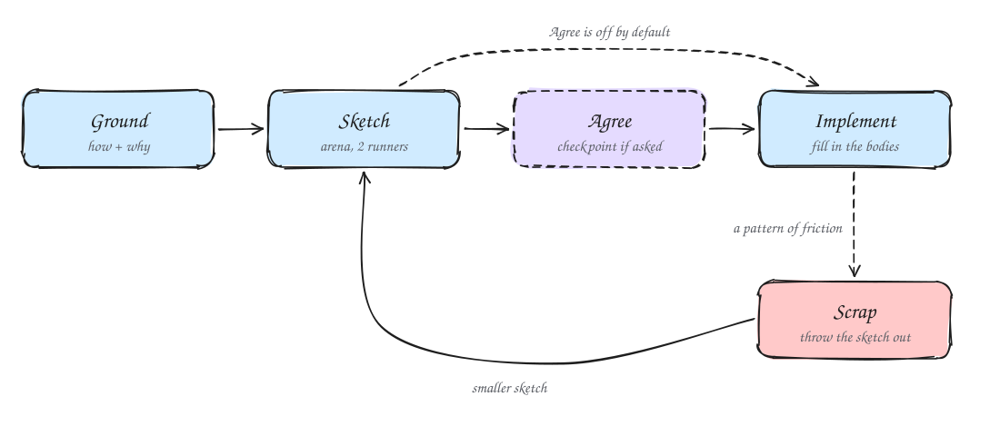
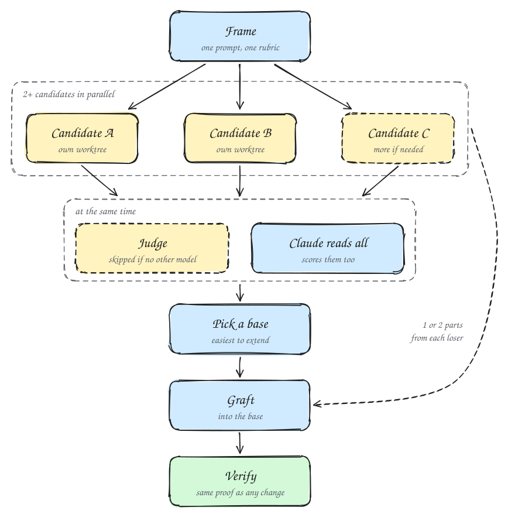

# Design before code

The first shape a model reaches for is rarely the best one, and once code grows around it, that shape is expensive to change. The commands here run several attempts or reviewers in parallel before the first real line, so you choose a design from several options instead of polishing the only one on the table.

## Write the shape as types first

`/orbit:architect` writes the design as code that does not run yet. You get types, function signatures, class shapes and module boundaries, with `not implemented` bodies and pseudocode where the logic will go. A reader can trace data from input to output through the signatures alone, and changing a boundary at this stage touches only signatures.

```text
/orbit:architect a retry policy for the upload client. callers should never see backoff or attempt counts.
```

Architect works in five phases:

1. **Ground.** It runs `/orbit:how` over every system the new code touches. When the design moves ownership or layering, it also runs `/orbit:why`, so the reason for the current shape becomes a constraint instead of a guess. Only greenfield work skips this phase.
2. **Sketch.** It runs `/orbit:arena` with two design runners, one on Opus and one on your session model. Each runner writes the caller's usage and a few real call sites first, then derives the types from them. Architect requires at least two structurally different candidates, even when the first looks good enough.
3. **Agree.** This phase is off by default, and the synthesized design goes straight to implementation. Ask for a checkpoint to review it first.
4. **Implement.** The code must match the sketch's signatures. Inside a flow, a poteto-agent fills in the bodies against it. If a function needs a parameter the sketch did not plan for, Claude treats that as a question about the sketch, not as friction to absorb.
5. **Scrap.** A pattern of friction means the design is wrong. The same workaround in unrelated places, types that compile only with `any` or casts, or a lock for state the sketch called unshared all count. Architect throws the sketch out, designs a smaller one, and runs the sketch phase again.

<picture>
  <source media="(prefers-color-scheme: dark)" srcset="../diagrams/guide-architect-dark.svg">
  
</picture>

To see the design before any code fills it in, say so in the prompt:

```text
/orbit:architect with checkpoint. move session storage out of the request handler into its own module.
```

The design rationale goes in the PR body when your project lands by PR. Otherwise it goes in the reply.

You rarely need to type architect. Orbit's rules send any code that crosses a function boundary through it, and step 2 of the feature flow runs it.

## Hold a bakeoff with `/orbit:arena`

On a non-trivial artifact, one attempt commits you to whatever shape that attempt happened to find. `/orbit:arena` runs several attempts at the same task, picks the strongest as a base, and folds the best ideas from the others into it.

<picture>
  <source media="(prefers-color-scheme: dark)" srcset="../diagrams/guide-arena-dark.svg">
  
</picture>

```text
/orbit:arena the file format for per-project overrides. 4 candidates, because it is hard to migrate later.
```

Each phase has one job:

- **Frame.** Every candidate gets the same prompt, so the attempts differ only in how they answer it. Claude also writes a rubric of 3 to 6 gradeable criteria for picking the winner. The candidates see only the task.
- **Fan out.** By default two `orbit:poteto-agent` runners work in parallel, one on Opus and one on your session model. More runners join when the task covers several design directions. Each writes to its own worktree where possible, else its own scratch directory, so the attempts stay independent.
- **Cross-judge.** One read-only judge scores every candidate on each criterion and recommends a base. It runs on whichever of Opus and your session model differs from Claude's own model.
- **Pick.** Claude reads every candidate end to end and scores each one against the rubric itself. It compares its pick with the judge's, since a disagreement means one of them is biased or the rubric was unclear. The base is the one a future maintainer can extend with the least risk of breaking its invariants.
- **Graft.** Claude walks each losing candidate for the one or two things worth porting. Claude folds the grafts in by hand instead of pasting them, so the result still reads as one design. Inside a flow, a fresh poteto-agent does the folding. If the candidates agree on one shape, no graft is needed. If they disagree wildly, the frame was too loose, and arena reframes and runs again.
- **Verify.** The merged result gets the same proof as any other change.

Arena returns one artifact and a short note that names the base, the judge's verdict, each graft and its source, and what was rejected.

In an Opus session, both runners and the judge run on Opus, so the panel loses its model diversity. Arena still gives you independent attempts, but they come from one model.

Arena also runs inside architect, and inside the feature flow when the code admits several valid shapes, such as two ways to handle errors or structure the tests.

## Spread wide work with `/orbit:swarm`

Arena produces one artifact. `/orbit:swarm` splits a wide job across workers, or races them on the same brief, and returns one report. Orbit's rules send coverage matrices, races, gauntlets and exploration partitions here, and design or code bakeoffs to arena.

```text
/orbit:swarm run the e2e suite at each of the last 6 commits on main. one worker per commit. report which commits fail.
```

Before it spawns anything, swarm states what "done" means and picks a shape:

- **Partition.** Each worker gets its own slice. Every slice needs a result, so the report shows any gap.
- **Race.** Several workers get identical briefs. The selection rule is declared before any worker starts, and it is `first pass`, `rank all` or `best-of`.
- **Mix.** Some workers get slices and some race.

Each worker runs in its own worktree on your session model and reports `PASS`, `ISSUES` or `BLOCKED` with evidence. Claude drops a result that does not record the commits and method its brief names, and respawns that worker once. A second miss is recorded as a gap. A gap never counts as a pass. You get one table in chat, not each worker's raw output.

## Invite a hostile review with `/orbit:interrogate`

A design that looks sound to the model that wrote it can still hide a flaw that model is blind to. `/orbit:interrogate` sends the change to two read-only reviewers, one on Opus and one on your session model. The disagreement comes from the models being different, not from assigned personas. In an Opus session, both reviewers run on Opus.

```text
/orbit:interrogate this branch. i think the new cache could serve one user's data to another.
```

Before it spawns the reviewers, Claude writes the change's intent in one paragraph. If the intent is unclear, it asks you. Both reviewers get the same template, rubric and code-quality lens. Findings that both models raised on their own carry the most weight.

Claude then judges as the lead reviewer and sorts every finding into one of four buckets:

| Bucket | Means |
| --- | --- |
| Act on | A real issue that would block a PR |
| Consider | Legitimate, but maybe not worth fixing now |
| Noted | Valid, but not actionable at this stage |
| Dismissed | Wrong or nitpicky, with a reason |

An agreement map shows where the two models agreed and split.

Interrogate never applies a fix. The verdict is judgment, the Dismissed bucket exists because reviewers are sometimes wrong, and you decide what changes.

The feature flow runs interrogate before shipping when a design is contested. You can also point it at an architect sketch before any body is filled in, which is the cheapest time to change the design.

## Run the question instead of asking it

Some design questions have an answer you can observe. Examples are which layout reads better at phone width, whether streaming beats buffering for a large file, and how long a cold start takes. Orbit's rules say a question like that is not yours to answer. Before Claude asks you "which approach?", it checks whether running something would settle it. If so, it builds a prototype and lets the result decide. It asks you only about product or preference calls that no experiment can settle.

```text
/orbit:start prototype the settings page as a sidebar and as tabs. screenshot both at phone width.
```

```text
/orbit:start sketch it to decide whether streaming the export beats building it in memory for a 50 MB file.
```

The prototype flow trades polish for speed:

1. It names the decision the prototype exists to make. With no decision, it routes to the feature flow instead.
2. It gathers prior art when the design space is open, and lets you pick directions first.
3. It builds in a scratch directory, away from your production source, with the lightest stack or the smallest script that shows the idea. There are no tests and no abstractions.
4. It puts the variants behind one switcher, so you compare them side by side.
5. It observes the result. That means screenshots of each variant for a visual decision, or logged output and timings for a behavioral one.
6. It presents the variants, the evidence, the tradeoffs and a recommendation.

The prototype is throwaway. It never runs Opening a PR and never ships. The chosen direction goes to the feature flow or to `/orbit:architect` for the real build.

## Let the defaults do most of it

Most of this runs without you typing a command. Architect runs for code that crosses a function boundary. Arena runs inside architect and on code with several valid shapes. Interrogate runs on a contested design. A question you could settle by running something becomes a prototype, not a question to you. Type a command yourself when you want more scrutiny than the default, or a fan-out the flow would not start on its own. The full command list is in [the usage reference](../usage.md#understand-code).

Next: [Build a change](./04-build-a-change.md)
