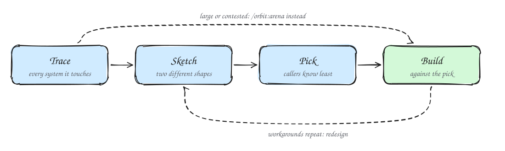
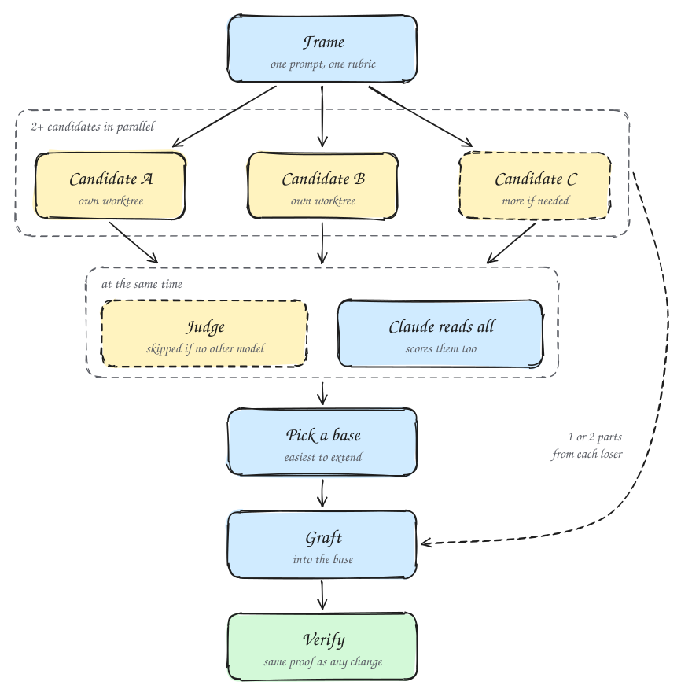

# Design before code

The first shape a model reaches for is rarely the best one, and once code grows around it, that shape is expensive to change. Most commands here run several attempts or reviewers in parallel before the first real line, so you choose a design from several options instead of polishing the only one on the table.

## Write the shape as types first

`/orbit:architect` settles the shape before any code. It sketches two different shapes for the change (types, signatures, module boundaries) and picks the one where each piece of state has one owner, each task has one way to do it, and callers need to know least.

```text
/orbit:architect a retry policy for the upload client. callers should never see backoff or attempt counts.
```

Architect works in three steps:

1. **Trace.** It traces every system the change touches. Inside a flow, it reuses an earlier `/orbit:how` answer when that answer covers those systems.
2. **Sketch.** It sketches two different shapes. For a large or contested design, it runs `/orbit:arena` instead of sketching alone.
3. **Pick.** It keeps the shape whose callers need to know least. If workarounds repeat once the build starts, it redesigns instead of patching.

<picture>
  <source media="(prefers-color-scheme: dark)" srcset="../diagrams/guide-architect-dark.svg">
  
</picture>

You rarely need to type architect. Orbit's rules send any code that crosses a function boundary through it, and step 2 of the feature flow runs it.

## Hold a bakeoff with `/orbit:arena`

On a non-trivial artifact, one attempt commits you to whatever shape that attempt happened to find. `/orbit:arena` runs several attempts at the same task, picks the strongest as a base, and folds the best ideas from the others into it.

<picture>
  <source media="(prefers-color-scheme: dark)" srcset="../diagrams/guide-arena-dark.svg">
  
</picture>

```text
/orbit:arena the file format for per-project overrides. 4 candidates, because it is hard to migrate later.
```

Each phase has one job:

- **Frame.** Every candidate gets the same prompt, so the attempts differ only in how they answer it. Claude also writes a rubric of 3 to 6 gradeable criteria for picking the winner. The candidates see only the task.
- **Fan out.** By default two `orbit:poteto-agent` runners work in parallel, one on the `judgment` model and one on the `code` model. More runners join when the task covers several design directions. Each writes to its own worktree where possible, else its own scratch directory, so the attempts stay independent.
- **Cross-judge.** One read-only judge scores every candidate on each criterion and recommends a base. It never runs on Claude's own model, so it takes the first of the `judgment` and `code` models that differs. When both are Claude's model, arena skips the judge and says so. In T3 Code with providers listed in `/orbit:setup`, the judge is a seat on another family instead ([Give the panels a second family in T3 Code](./08-make-it-fit.md#give-the-panels-a-second-family-in-t3-code)).
- **Pick.** Claude reads every candidate end to end and scores each one against the rubric itself. When a judge ran, Claude compares its pick with the judge's, since a disagreement means one of them is biased or the rubric was unclear. The base is the one a future maintainer can extend with the least risk of breaking its invariants.
- **Graft.** Claude walks each losing candidate for the one or two things worth porting. Claude folds the grafts in by hand instead of pasting them, so the result still reads as one design. Inside a flow, a fresh poteto-agent does the folding. If the candidates agree on one shape, no graft is needed. If they disagree wildly, the frame was too loose, and arena reframes and runs again.
- **Verify.** The merged result gets the same proof as any other change.

Arena returns one artifact and a short note that names the base, the judge's verdict or that arena skipped the judge, each graft and its source, and what was rejected.

When the `judgment` and `code` models are the same, as in an Opus session under the defaults, both runners run on one model and arena skips the judge, so the panel loses its model diversity. Arena still gives you independent attempts, but they come from one model, and Claude picks the base alone. In T3 Code with providers listed in `/orbit:setup`, the judge runs on another family, so arena keeps it unless every listed provider fails.

Arena also runs inside architect for a large or contested design, and inside the feature flow when the code admits several valid shapes, such as two ways to handle errors or structure the tests.

## Spread wide work with `/orbit:swarm`

Arena produces one artifact. `/orbit:swarm` splits a wide job across workers, or races them on the same brief, and returns one report. Orbit's rules send coverage matrices, races, gauntlets and exploration partitions here, and design or code bakeoffs to arena.

```text
/orbit:swarm run the e2e suite at each of the last 6 commits on main. one worker per commit. report which commits fail.
```

Before it spawns anything, swarm states what "done" means and picks a shape:

- **Partition.** Each worker gets its own slice. Every slice needs a result, so the report shows any gap.
- **Race.** Several workers get identical briefs. The selection rule is declared before any worker starts, and it is `first pass`, `rank all` or `best-of`.
- **Mix.** Some workers get slices and some race.

Each worker runs in its own worktree on the `code` model and reports `PASS`, `ISSUES` or `BLOCKED` with evidence. Claude drops a result that does not record the commits and method its brief names, and respawns that worker once. A second miss is recorded as a gap. A gap never counts as a pass. You get one table in chat, not each worker's raw output.

## Invite a hostile review with `/orbit:interrogate`

A design that looks sound to the model that wrote it can still hide a flaw that model is blind to. `/orbit:interrogate` sends two adversaries to break the change, one on the `judgment` model and one on the `code` model, each in its own worktree. When those two models are the same, as in an Opus session under the defaults, both adversaries run on one model. In T3 Code with providers listed in `/orbit:setup`, a seat on another family replaces the `code` adversary. When every listed provider fails, the `judgment` adversary runs alone.

```text
/orbit:interrogate this branch. i think the new cache could serve one user's data to another.
```

Before it spawns the adversaries, Claude restates the change's intent in its own words, from your message, the commits and the PR description. If the intent is unclear, it asks you. Each adversary gets the scope, the intent and the project's review sources, and must prove every finding with a run against the real code. A run is a failing test, a repro script, or command output that shows the wrong behavior. A finding about style or naming, or a risk that needs a future change to matter, doesn't count, because no run can show it.

Claude then reruns each finding's command in that adversary's worktree. A finding survives when the output shows the failure and the failure breaks the intent. Findings with one root cause merge into one. Claude removes the adversary worktrees once every finding is checked.

The report has four parts:

| Part | Holds |
| --- | --- |
| Intent | Claude's restatement of what the change is for |
| Fixed first | Each known issue fixed before the audit, with its commit, or why that step was skipped |
| Findings | Each verified finding, with its command, its output, how it breaks the intent and the adversaries that found it, or "no verified findings" |
| Dropped | For each adversary, how many findings Claude dropped and why |

Interrogate never fixes its own findings. Known issues, such as review comments that hold up or a failing Check, get fixed first by a code delegate, so the adversaries audit the fixed code. The two adversaries find different failures, so the report keeps every verified finding from both, and you decide what changes.

The feature flow runs interrogate before shipping when a design is contested. You can also point it at an architect sketch before any body is filled in, which is the cheapest time to change the design.

## Run the question instead of asking it

Some design questions have an answer you can observe. Examples are which layout reads better at phone width, whether streaming beats buffering for a large file, and how long a cold start takes. Orbit's rules say a question like that is not yours to answer. Before Claude asks you "which approach?", it checks whether running something would settle it. If so, it builds a prototype and lets the result decide. It asks you only about product or preference calls that no experiment can settle.

```text
/orbit:start prototype the settings page as a sidebar and as tabs. screenshot both at phone width.
```

```text
/orbit:start sketch it to decide whether streaming the export beats building it in memory for a 50 MB file.
```

The prototype flow trades polish for speed:

1. It names the decision the prototype exists to make. With no decision, it routes to the feature flow instead.
2. It gathers prior art when the design space is open, and lets you pick directions first.
3. It builds in a scratch directory, away from your production source, with the lightest stack or the smallest script that shows the idea. There are no tests and no abstractions.
4. It puts the variants behind one switcher, so you compare them side by side.
5. It observes the result. That means screenshots of each variant for a visual decision, or logged output and timings for a behavioral one.
6. It presents the variants, the evidence, the tradeoffs and a recommendation.

The prototype is throwaway. It never runs Opening a PR and never ships. The chosen direction goes to the feature flow or to `/orbit:architect` for the real build.

## Let the defaults do most of it

Most of this runs without you typing a command. Architect runs for code that crosses a function boundary. Arena runs inside architect for a large or contested design, and on code with several valid shapes. Interrogate runs on a contested design. A question you could settle by running something becomes a prototype, not a question to you. Type a command yourself when you want more scrutiny than the default, or a fan-out the flow would not start on its own. The full command list is in [the usage reference](../usage.md#understand-code).

Next: [Build a change](./04-build-a-change.md)
