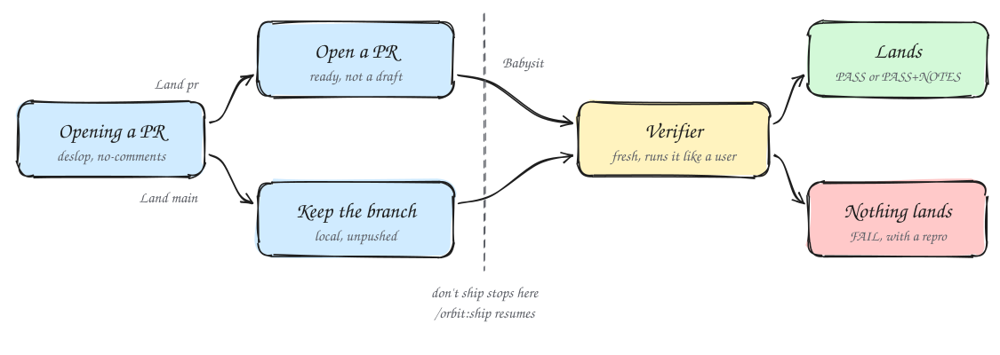
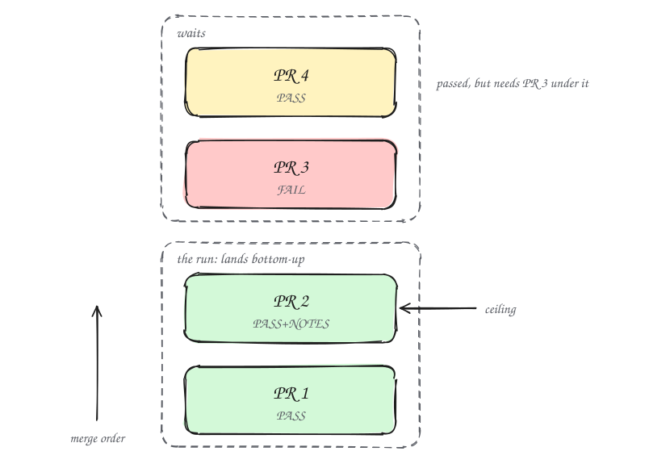

# Prove it works, then ship

A change isn't done when it compiles or when its tests go green. Before a change lands, Shipping hands it to an agent that never saw the code, has it run the change the way a user would, and lands only what that agent passes.

## Passing tests are not a verdict

The agent that wrote a change usually wrote its tests too. Both come from the same idea of what the change should do, so they share the same blind spots. A green suite proves the code agrees with itself. It doesn't prove the save button keeps the record, or that the command prints the rows you asked for.

In the Shipping playbook, green CI and an approving bot review are not verdicts, because neither runs the change as a user would. Only a verdict from an agent that did not write the code counts, because an author checks what it meant to build.

## From a built change to a landed one

<picture>
  <source media="(prefers-color-scheme: dark)" srcset="../diagrams/guide-ship-dark.svg">
  
</picture>

Every change ends in Opening a PR. It runs `/orbit:deslop` over the diff and `/orbit:no-comments` before review, and writes the title and description to a fixed shape. The title is a Conventional Commit such as `feat(export): add a --since flag`. The body is a one-minute briefing with sections such as `## Why`, `## Scope` and `## Verification`. [Build a change](./04-build-a-change.md) covers the commits that come before it.

What opens next depends on the Land line in your project's Workflow block. Leave it out and Land is `main`.

- **Land `pr`.** gitops pushes the task branch as `<type>/<slug>` and opens a ready PR, never a draft. Babysit then drives it to merge-ready.
- **Land `main`.** Nothing is pushed and no PR opens. The branch stays committed in its worktree until Shipping fast-forwards `main` to it. The project's Check line stands in for CI.

[Make orbit fit your project](./08-make-it-fit.md) shows where the Land line goes. Either way, the same verifier decides what lands.

## The verifier runs your change like a user

Shipping spawns one `verifier` per PR, fresh, in its own worktree. It has Read, Grep, Glob and Bash. It has no Edit or Write, so it can't patch what it finds and then pass its own patch. It commits nothing.

Its brief holds the head SHA, the parent SHA, a paragraph on what the change is for, the changed paths, and the skill that drives your app. It checks out the head, runs the change, then checks out the parent and runs the same steps again. That second run is what turns an observation into evidence. "The export prints 40 rows" says little. "The parent printed 52 rows and the head prints 40, and the 12 missing rows are older than `--since`" says the change did its job.

It answers with one of three verdicts:

- `PASS`. The change does what its intent says.
- `PASS+NOTES`. It passes, and the reply lists the parts the verifier couldn't run.
- `FAIL`. It broke, the run was inconclusive, or the run drove the wrong screen or command. The reply carries the smallest repro.

An inconclusive run counts as `FAIL` on purpose. A verifier that couldn't tell should never wave a change through. Under Land `pr`, gitops posts the verdict on the PR as one line with the SHA and the patch-id. Under Land `main`, the verdict goes in the reply.

## Give the verifier a way to drive your app

The verifier needs a way to start and drive your app. With nothing else, it falls back to orbit's `control-ui` skill for browser, Electron and web UIs, or `control-cli` for CLIs and TUIs. Each builds or adapts a local harness on the spot. That works, but each run rediscovers how your app starts, where its ports are, and what to click.

Run this once in a project that users can run or install:

```text
/orbit:create-verification-skill
```

Claude reads the repo, asks you only what it can't observe, and writes `.claude/skills/verify-<app>/`. Its SKILL.md has six sections:

- **Launch** starts the app and says how to tell it's ready.
- **Doctor** is one read-only health check.
- **Drive** uses the repo's real selectors and commands.
- **Evidence** says what to capture and where it goes.
- **Cleanup** tears down only what the run started and keeps the evidence.
- **Helpers** shows how to run any script the skill ships.

A feature map in `features/` has an index plus one file per feature. Each file says how a user reaches the feature, how to drive it, and what end state proves it worked. Claude runs the new skill once end to end before handing it over, so you know it can launch and drive the app before the verifier relies on it. From then on, the verifier uses it on every change and reports where the evidence is.

Apps change, and the map drifts. When it does, run:

```text
/orbit:maintain-verification-skill
```

It reads each feature's source in parallel, drives every feature live, and ends `clean`, `changed` or `blocked`. It edits only the verification skill's own folder. A feature that broke in the app is reported as a bug, never rewritten out of the map. Both commands run only when you type them.

## Check a number before you report it

A measured speedup can be wrong in ways that look right. A run where half the requests failed fast can look faster. A side left on a debug build or a commit per row compares settings, not code. Before Claude reports or acts on a number it measured, it reads the `benchmark-checklist` skill and answers its seven questions with evidence from a run. The verdict is faster, slower, no measurable difference, or inconclusive, with the run count, the range and what limits the number.

```text
you said the csv import is 30% faster. run that through the benchmark checklist before it goes in the PR.
```

The PR body then carries one primary number. The runs and the evidence go in a linked file.

## Babysit drives a PR to merge-ready

Opening a PR doesn't start a babysit. Claude posts the URL and keeps building until the whole stack exists, because babysitting each new PR stalls the build and spends checks on commits that later waves will restart. When the task ships by default, Babysit then runs in `drive` mode. You can also ask for it on any open PR.

Babysit declares a mode before it polls:

- `drive` loops until the PR is merge-ready. "babysit this" and "get it green" ask for it.
- `background` triages without blocking, for a plan that is still running.
- `threads-only` answers review comments and touches nothing else.
- `check` is one status pass and a report.

```text
check on PR 214. anything outstanding?
```

```text
address the review comments on PR 214, nothing else
```

It works the lowest unmerged PR first. It clears conflicts first, then review threads, then CI. A conflict is the one blocker it reports instead of fixing, because a babysit never rebases or force-pushes. CI failures get classified first. A flake earns one fresh build, and only one. A second identical failure means it was never a flake. Babysit stops at merge-ready and never merges. Under Land `main` there is no PR to watch, so it says so and stops.

## Read bot reviews with suspicion

Bugbot and the agentic security review catch real bugs, and they also file noise. Babysit triages each comment against the code as `fix`, `dismiss` or `ask`, per the playbook's `references/bugbot-triage.md`. A real finding gets a fix in the lowest PR that owns the code. Noise gets a reply on the thread with the concrete reason it doesn't apply. A finding about security, auth, billing, data or migrations is never dismissed on Claude's own judgment. Claude fixes it or asks you. It never churns code just to quiet a bot. When a dismissal pattern looks useful to the team, Babysit offers it as a new entry in that rubric, in its own PR.

## Shipping lands only the verified run

Shipping verifies each PR first, then walks up from the lowest unmerged PR and stops at the first one without `PASS` or `PASS+NOTES`. Everything below that point is the run, and the top PR of the run is the ceiling. A verified PR above an unverified one waits, because it can't land without the code underneath it.

<picture>
  <source media="(prefers-color-scheme: dark)" srcset="../diagrams/guide-stack-dark.svg">
  
</picture>

Before it trusts an older verdict, Shipping compares the patch-id at the verdict SHA with the current head. A rebase moves every PR above it to a new SHA without failing a check, so a verdict covers a patch, not a commit. Then it merges bottom-up, one PR at a time, with `--squash` unless your Land line names another method. It reads each PR back afterward, because a merge command can report success when a merge queue only queued the PR. Under Land `main`, it rebases each branch onto `origin/main`, runs the Check line, and pushes it to `main` one branch at a time, with no force-push.

## Land later with /orbit:ship

Put "don't ship" or "I'll land it" in a goal, and the task stops at the PR, or at the branch under Land `main`. The reply gives the PR link, or the worktree path and branch, and ends with `Next: /orbit:ship`. When you're ready, run it:

```text
/orbit:ship
```

It runs the same Shipping playbook, so a fresh verifier still runs first. You can add notes after the command. For the full command list, see [Every command](../usage.md#every-command).

Next: [Work while you're away](./06-hands-off.md)
