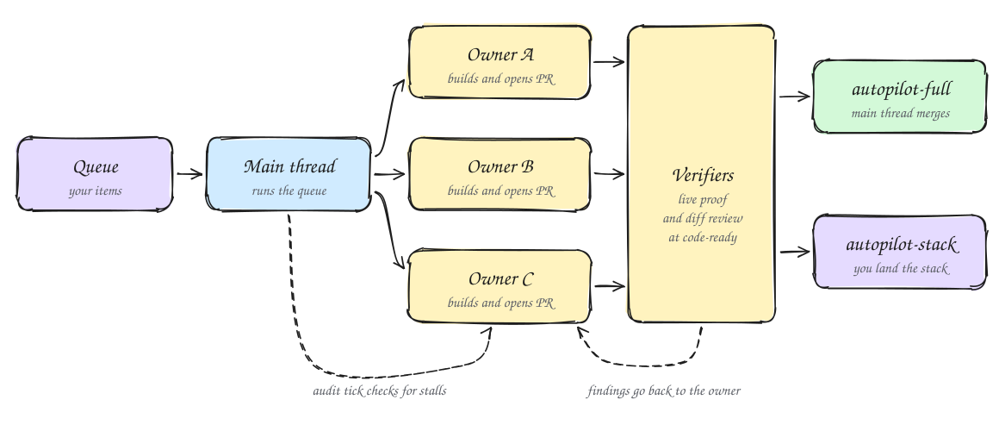

# Work while you're away

Orbit has flows that carry a whole queue of changes without you, a planner for work that spans many PRs, and a decision trail you can check when you're back. Every flow here keeps a fresh verifier between the work and `main`, so nothing lands on an agent's own word.

## Run a queue with an autopilot

Give `/orbit:start` a list of independent changes and ask it to autopilot them.

```text
/orbit:start autopilot this queue: add retries to the webhook sender, cache the feature flag lookup, delete the unused legacy_sessions table
```

That routes to the `autopilot-full` flow. The main thread keeps the queue and starts one owner per ready item, each in its own worktree. Each owner runs `/orbit:start` on its item, opens its PR and returns the head and proof. The main thread babysits the PR and hands fixes back to the owner.

<picture>
  <source media="(prefers-color-scheme: dark)" srcset="../diagrams/guide-autopilot-dark.svg">
  
</picture>

**Each branch has one writer.** Owners keep a decision trail in `$TMPDIR/orbit-autopilot/<slug>/` and commit each finished unit. A replacement picks up from the branch and trail.

**Independent verification gates landing.** Each code-ready patch gets a live check and diff review from the swarm. CI covers routine checks, and a minor fix gets a focused independent recheck. When the verdict covers the patch and checks are green, the main thread merges and reads the PR back.

The main thread advances the queue when an owner finishes or a PR changes. For unattended work, a scheduled audit checks the trails for stalls. Items you reserve stop at merge-ready. Say stop to cancel running delegates.

## Stack it when you want to land it yourself

Sometimes you want to read the work before it merges, or the items build on each other.

```text
/orbit:start build the stack, I'll land it: split the settings page into tabs, add a notifications tab, move billing into its own tab
```

That routes to `autopilot-stack`. It runs the same owners and the same verification as `autopilot-full`, but it stops at verified. Each owner stops once its PR is verified and green at its current head, and the root hands the PRs to you. After the handoff, nothing is pushed without your go.

Most PRs still branch from trunk. A PR stacks only on a PR it builds on. Its owner starts from the parent's branch and rebases onto it, not onto trunk. When the parent gets a new head, the owner restacks its PR onto the parent's branch. If the restack leaves the PR's patch-id unchanged, the PR keeps its verdict.

You get a list of PRs, each with its verdict. Land them with `/orbit:ship`, which lands a stacked PR after its parent, as [Prove it works, then ship](./05-prove-and-ship.md) describes.

Pick `autopilot-full` when you're happy for the PRs to merge. Pick `autopilot-stack` when you land them yourself.

## Plan work that spans many PRs

A large change goes better as a plan you can read before anything runs.

```text
/orbit:start multi-PR plan: move the job queue from Redis to Postgres without dropping in-flight jobs
```

The `multi-phase-plan` flow writes the plan and does not implement it. If the change is one or two files with an obvious approach, it says so and stops. Otherwise it settles open questions with throwaway prototypes first, so the plan rests on what a run showed. A fork no run settles goes to the advisor, and Claude acts on its pick. It asks you only before an irreversible write, at a gate you named, or when the pick drops or changes what you asked for.

The plan is a checklist with one section per PR. Each section names the files, what to build, what you should see, and the boxes that prove it. A PR counts as verified only when its unit, live and perf boxes are all checked, because tests alone are not sufficient verification. A PR that changes an interaction is review-gated, so it waits for your review before it merges.

The flow posts the plan's path and stops. On your explicit go, it runs under `autopilot-full` or `autopilot-stack`. It picks `autopilot-full` when the run may merge, and `autopilot-stack` when you said "don't ship" or "I'll land it".

## When no flow fits, Claude designs one

A large migration or a run you plan to leave alone goes to `/orbit:figure-it-out`. `/orbit:start` routes it there too.

```text
/orbit:figure-it-out migrate every date helper in the web app from moment to date-fns. I'm stepping away until tonight.
```

Before any code, it designs the run. It writes down what done means as a check that can fail, how big the work is, and how much rigor it needs. One-way doors get more. It builds the check first, with a baseline from before the change, so each result reads as old value against new value. Each unit is then an experiment that is kept if it moved the check and reverted if it didn't. A result is `VERIFIED`, `NOT VERIFIED` or `INCONCLUSIVE`, and inconclusive is not a pass.

It shows you that framing before a long run starts, and a multi-hour run earns one checkpoint with you. Phrases such as "going to bed" or "run until done" tell Claude to keep going without you.

## Check the run through its decision trail

Long, unattended or multi-phase work keeps a decision trail through the `show-me-your-work` skill. Claude starts one on its own for that kind of work, and you can ask for it with `/orbit:show-me-your-work`. The trail is a TSV file with one row per decision. Two rows from a date-helper migration look like this:

```text
ts	phase	decision	why	evidence	result
2026-05-24T09:40:00Z	harness	saved the output of every date helper before changing anything	so each result reads as old value against new value	scripts/snapshot.sh, baseline/	120 outputs saved
2026-05-24T11:15:00Z	format	moved formatDate to date-fns	smallest unit that the baseline can check	commit 7c21e0a	outputs identical, tests green
```

The `evidence` cell always points at something you can open, such as a commit, a PR, a `file:line` or a screenshot.

The trail is append-only. A wrong call gets a new row that supersedes it, so the history stays honest. It stays out of git unless a reviewer needs it to trust the result. figure-it-out runs usually commit theirs.

Before handing back, Claude checks each row against the session's transcript. Then a reviewer on another model reads the trail and flags weak evidence and skipped checks. In T3 Code with providers listed in `/orbit:setup`, the reviewer is the seat on another family. Otherwise it runs on Sonnet when Claude runs on Opus, else on Opus. The reply ends with an Attention section. When every listed provider fails, that section opens with `not reviewed: seat on another family skipped`. Read the Attention section first, then follow its pointers into the rows. For a quick status instead, run `/orbit:ketchup`.

## Stop cleanly, pick up later

When you need to stop mid-task, switch model, or close the session, say so or run:

```text
/orbit:pause-safely
```

Claude finishes or backs out of the current step and starts nothing new. It commits uncommitted edits as one `wip:` commit, leaves the worktree in place, and writes a resume note to its memory folder, not the repo. Each paused task gets its own note, named after the task's slug, so a pause in another session never overwrites it. The reply names the first action to take on resume. Pausing takes no irreversible step, so it opens no PR and pushes nothing unless a PR was already out. "keep going" or "don't stop" never pauses.

In a new session, run `/orbit:session-pickup`. It reads the last session's transcript, the git log and the resume note, works out what is done and what is left, and routes the rest through `/orbit:start` or Opening a PR. It treats the earlier trail as true and doesn't redo finished work. It does check the inherited claims on the real artifact, because a passing self-report is not proof.

Next: [Steer with principles](./07-steer-with-principles.md)
