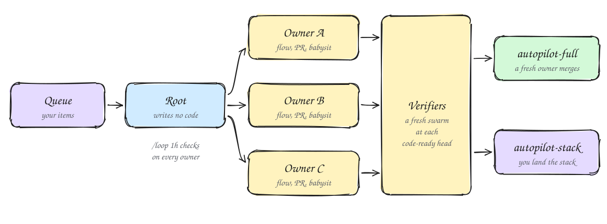

# Work while you're away

Orbit has flows that carry a whole queue of changes without you, a planner for work that spans many PRs, and a decision trail you can check when you're back. Every flow here keeps a fresh verifier between the work and `main`, so nothing lands on an agent's own word.

## Run a queue with an autopilot

Give `/orbit:start` a list of independent changes and ask it to autopilot them.

```text
/orbit:start autopilot this queue: add retries to the webhook sender, cache the feature flag lookup, delete the unused legacy_sessions table
```

That routes to the `autopilot-full` flow. Its root agent writes no code. It spawns one owner per item, each in its own worktree off trunk, and the owners run in parallel. Each owner runs `/orbit:start` on its item, so the item goes through the same flow it would get as a single task, Opening a PR included. Then the owner babysits its own PR to merge-ready.

<picture>
  <source media="(prefers-color-scheme: dark)" srcset="../diagrams/guide-autopilot-dark.svg">
  
</picture>

**Each branch has one writer.** The root never pushes a fix to an owner's branch. It sends findings back, and the owner fixes them. Two agents writing one branch undo each other's work.

**The playbook assumes an owner can die.** Each owner keeps a decision trail in the run's store under `$TMPDIR/orbit-autopilot/<slug>/` and commits after every unit worth keeping. A replacement owner reads that trail and the branch, and picks up where the last one stopped.

**Nothing merges on the owner's word.** When an owner's code is clean and rebased onto trunk, it records a `code-ready` head in its trail. The root then fans out a swarm of fresh verifiers at that SHA. They rerun the Check line, drive the change live through your verify skill, and audit the diff. A later rebase or small fix gets a single verifier at the new head. Only new behavior, a redesign or a large new diff gets the full swarm again.

Once the owner reports merge-ready and its head is verified, a fresh owner takes the merge round. It checks that the code still matches what the verifiers passed, merges, and reads the PR back. Green CI alone never authorizes a merge.

On your go, the root arms `/loop 1h`. Each tick reads every owner's trail, starts verification at each new `code-ready` head, and replaces any agent that has stalled. You keep your gates. Items you name as yours stop at merge-ready. Asking the root to state its plan is not a go. Say stop, and every owner gets an order to make no more writes and reports where it stands.

## Stack it when you want to land it yourself

Sometimes you want to read the work before it merges, or the items build on each other.

```text
/orbit:start build the stack, I'll land it: split the settings page into tabs, add a notifications tab, move billing into its own tab
```

That routes to `autopilot-stack`. It runs the same owners and the same verification, minus the landing. Owners never merge, retarget, close a PR or arm auto-merge. An item that depends on another branches from that item's branch, not from trunk. Only the root rebases or retargets a link in the chain, because two writers on one chain undo each other.

You get one linear stack of PRs, each based on the one below and carrying its own verdict. Land it with `/orbit:ship`, which walks the stack from the bottom as [Prove it works, then ship](./05-prove-and-ship.md) describes.

Pick `autopilot-full` when the items are independent and you're happy for them to merge. Pick `autopilot-stack` when you want to review first, when the work is sequenced or coupled, or when you're keeping merge authority.

## Plan work that spans many PRs

A large change goes better as a plan you can read before anything runs.

```text
/orbit:start multi-PR plan: move the job queue from Redis to Postgres without dropping in-flight jobs
```

The `multi-phase-plan` flow writes the plan and does not implement it. If the change is one or two files with an obvious approach, it says so and stops. Otherwise it settles open questions with throwaway prototypes first, so the plan rests on what a run showed. It asks you only about product or preference calls that no run can settle.

The plan is a checklist with one section per PR. Each section names the files, what to build, what you should see, and the boxes that prove it. A PR counts as verified only when its unit, live and perf boxes are all checked, because tests alone are not sufficient verification. A PR that changes an interaction is review-gated, so you see screenshots and a video in chat before it merges.

The flow lints the plan with `check-plan.mjs`, posts the plan's path, and stops. On your explicit go, it runs under `autopilot-full` or `autopilot-stack`. It picks `autopilot-stack` when the PRs are sequenced or coupled, or when you said "don't ship" or "I'll land it".

## When no flow fits, Claude designs one

A large migration or a run you plan to leave alone goes to `/orbit:figure-it-out`. `/orbit:start` routes it there too.

```text
/orbit:figure-it-out migrate every date helper in the web app from moment to date-fns. I'm stepping away until tonight.
```

Before any code, it designs the run. It writes down what done means as a check that can fail, how big the work is, and how much rigor it needs. One-way doors get more. It builds the check first, with a baseline from before the change, so each result reads as old value against new value. Each unit is then an experiment that is kept if it moved the check and reverted if it didn't. A result is `VERIFIED`, `NOT VERIFIED` or `INCONCLUSIVE`, and inconclusive is not a pass.

It shows you that framing before a long run starts, and a multi-hour run earns one checkpoint with you. Phrases such as "going to bed" or "run until done" tell Claude to keep going without you.

## Check the run through its decision trail

Long, unattended or multi-phase work keeps a decision trail through the `show-me-your-work` skill. Claude starts one on its own for that kind of work, and you can ask for it with `/orbit:show-me-your-work`. The trail is a TSV file with one row per decision. Two rows from a date-helper migration look like this:

```text
ts	phase	decision	why	evidence	result
2026-05-24T09:40:00Z	harness	saved the output of every date helper before changing anything	so each result reads as old value against new value	scripts/snapshot.sh, baseline/	120 outputs saved
2026-05-24T11:15:00Z	format	moved formatDate to date-fns	smallest unit that the baseline can check	commit 7c21e0a	outputs identical, tests green
```

The `evidence` cell always points at something you can open, such as a commit, a PR, a `file:line` or a screenshot.

The trail is append-only. A wrong call gets a new row that supersedes it, so the history stays honest. It stays out of git unless a reviewer needs it to trust the result. figure-it-out runs usually commit theirs.

Before handing back, Claude checks each row against the session's transcript. Then a reviewer on a different Claude model reads the trail and flags weak evidence and skipped checks. The reply ends with an Attention section. Read that first, then follow its pointers into the rows. For a quick status instead, run `/orbit:ketchup`.

## Stop cleanly, pick up later

When you need to stop mid-task, switch model, or close the session, run:

```text
/orbit:pause-safely
```

Claude finishes or backs out of the current step and starts nothing new. It commits uncommitted edits as one `wip:` commit, leaves the worktree in place, and writes a resume note to its memory folder, not the repo. Pausing takes no irreversible step, so it opens no PR and pushes nothing unless a PR was already out. "keep going" or "don't stop" never pauses.

In a new session, run `/orbit:session-pickup`. It reads the last session's transcript, the git log and the resume note, works out what is done and what is left, and routes the rest through `/orbit:start` or Opening a PR. It treats the earlier trail as true and doesn't redo finished work. It does check the inherited claims on the real artifact, because a passing self-report is not proof.

Next: [Steer with principles](./07-steer-with-principles.md)
