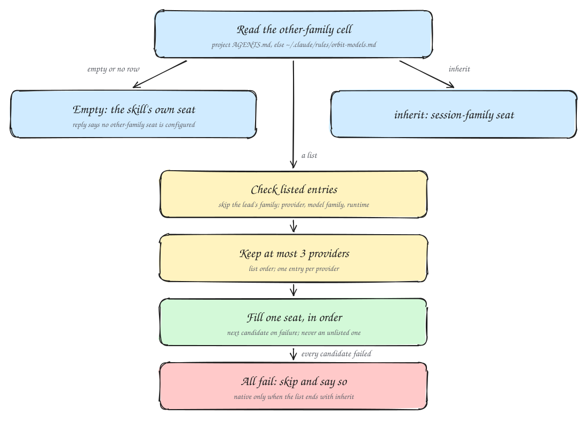

# Orbit in T3 Code

T3 Code runs orbit under a Claude lead and under a lead on another provider, such as Grok or Codex. This record says how orbit loads, finds T3's tools, fills panel seats, spawns subagents and resolves paths in each case. The [host adapter](../plugin/docs/harness/t3-code.md) holds the rules a lead follows. The [README](../README.md#run-on-any-provider-in-t3) holds the setup.

<picture>
  <source media="(prefers-color-scheme: dark)" srcset="diagrams/t3-lead-dark.svg">
  
</picture>

## How orbit loads

A Claude lead loads orbit as a Claude Code plugin. Its SessionStart hook prints `plugin/rules.md` into the context, so Non-negotiables is there before the first reply.

A lead on another provider gets orbit from Claude Code's install record, `~/.claude/plugins/installed_plugins.json`. Grok reads the plugin's `installPath` from that record when orbit is enabled in Claude Code's user settings. Grok ignores a project's `.claude/settings.json`. A copy in `~/.grok/plugins/`, or one from `grok plugin install`, wins over the record, and Grok still loads orbit once. Orbit has no per-provider install. `/orbit:setup` finds a Grok install of its own and prints `grok plugin uninstall orbit` for the user to run, so Grok falls back to Claude Code's copy. `claude plugin update orbit@orbit` moves the record to a fresh copy of the new version, so it also updates what Grok loads. A directory marketplace updates Claude Code's copy on `git pull`, but Grok's copy only on `claude plugin update`.

Codex does not read Claude Code's install record. With orbit enabled in Claude Code, Codex listed no orbit skills. `/orbit:setup` therefore links `~/.codex/skills/orbit` to the folder Claude Code installs orbit from, the marketplace's `installLocation` joined with the plugin's `source`, `./plugin`. A directory marketplace's `installLocation` is the repo folder. A GitHub marketplace's is a shallow clone at `~/.claude/plugins/marketplaces/orbit`. The link skips Claude Code's install path because that path holds the version number and changes on every update. Codex then lists every skill as `orbit:<name>`, a prefix it takes from the link's folder name, and `$orbit:rules` reads `rules.md` through `../../rules.md`. Codex loads no orbit agents.

The same link works from `~/.agents/skills/orbit`, but Grok also scans `.agents/skills/`, so orbit uses `~/.codex/skills/orbit`. A link to `plugin/skills` alone lists the skills, but `../../rules.md` then misses. A linked Codex plugin cache folder loads nothing. `codex plugin marketplace add` reads orbit's marketplace file and installs it, but that is a second install, and orbit has one install, in Claude Code. Codex skips a second link to a folder it already loads, but two copies that resolve to different folders, such as a project's `.agents/skills/orbit` and the user link, both load. Setup reports an extra copy and prints its removal for the user to run. Codex follows the marketplace source, so `claude plugin marketplace update orbit` updates it. `claude plugin update orbit@orbit` does not pull a GitHub marketplace's clone. Claude Code children still load the record's version, which on the test machine was 0.29.3 against a source at 0.45.0. Setup compares the two versions and offers both updates on a mismatch. The Codex and Claude Code results in these two paragraphs were measured on 2026-11-16, with codex-cli 0.169.0 in a scratch home.

Grok drops the SessionStart hook output, and Codex loads only orbit's skills. `/orbit:start` therefore loads the `rules` skill when Non-negotiables is not in context, and the skill reads `../../rules.md`. A Claude lead skips that step, because the hook already printed the rules. A user who wants the rules in every session, even without `/orbit:start`, adds one line to the provider's own instruction file, as the README shows. Orbit writes that file only when the user says yes during `/orbit:setup`.

## Find T3's tools

T3 serves its tools as MCP tools, and a step probes each tool before its first call. A tool that is not present takes the adapter's absent column, so orbit keeps working outside T3.

- A Claude lead finds a tool in its tool list, or loads it with `ToolSearch`.
- A lead on another provider uses its own tool search with the bare name. Grok finds `t3-code__list_thread_pull_requests` with `search_tool` and calls it with `use_tool`. With no tool search, a tool is present when its name is in the tool list. Otherwise the first real call is the probe, and an error means absent. The lead never probes with dummy arguments, because a dummy `delegate_task` starts a thread.

## Fill a panel seat on another family

A review panel fills one seat on a model family other than the session's.

- The lead calls `orchestrator_capabilities` once per thread and reuses the result, and calls it again only after an error or a user-named provider change, or with `search` for a model the Models table names.
- The `other-family` row comes from the project's AGENTS.md, else from `~/.claude/rules/orbit-models.md`, which `/orbit:setup` writes. The roster is the list of providers in its Model cell.
- An empty cell runs no seat on another family, and the reply says that none is configured. `inherit` keeps the session-family seat.
- A list tries at most three listed providers outside the session's family, in list order, and never a provider the list leaves out.
- An explicit model pick is checked with `search` before it is called unavailable.
- An unavailable entry goes in the reply with its reason.
- The seat runs through `delegate_task`, reads only, and its child thread is settled when it returns.
- Seats that write code never take a roster seat. They run on the lead's provider.

Orbit assumes no provider beyond the lead's own. Each seat on another family comes from a provider the user listed, checked at run time.

## Provider selection

The `other-family` Model cell resolves to one of four outcomes. The [host adapter](../plugin/docs/harness/t3-code.md) holds them as one table.

- An empty cell, or no row, runs the skill's session-family seat, as outside T3. The reply says that no seat on another family is configured and that `/orbit:setup` lists providers.
- `inherit` runs the session-family seat, with no line.
- A list gives at most three candidates, one per provider, in list order. An entry is a candidate when its provider is outside the session's family, is enabled, can run a cross-provider child task, lists models and offers the parent's runtime mode for a seat that runs commands. Its model must also pass the family check. The lead tries the candidates in order for one seat. They are fallbacks, not more reviewers.
- When every candidate fails at a check or after its spawn, the seat is skipped, and the reply says `Skipped <skill>'s seat on another family: every listed entry failed.` A list that ends with `inherit` runs the session-family seat instead. The verifier never skips. With no `inherit`, the lead asks the user before a native verifier runs, or holds the PR when no user can answer.

The family check reads the model, not only the provider. A provider's `driverKind` does not name the family of every model it serves, and an aggregator can serve the session's own family. A model is of the session's family when any token of its `id` matches the family word of `inheritedModel` or of a model the session's own provider lists. A model named `auto` or `default` is opaque, so its seat says `family unverified`.

`/orbit:setup` recommends a list ranked Claude, Codex, Muse, Gemini, then Grok. For each enabled lead kind it takes the first three ranked providers outside that kind, and it recommends the union of those picks. Setup also refuses a list entry that no lead would ever reach under the cap of three, so setup and run time agree.

<picture>
  <source media="(prefers-color-scheme: dark)" srcset="diagrams/provider-selection-dark.svg">
  
</picture>

## Spawn subagents under another lead

A lead on another provider runs every orbit agent with its native subagent tool, such as Grok's `spawn_subagent`. Children that write code in the lead's checkout run this way too, so they stay on the lead's provider. T3 shows each one as a nested node in the same thread, not as a new thread. Grok ignores an agent's `model` field, so a native subagent runs on the lead's own model. A Models cell that names a Claude model is skipped under such a lead, so that spawn runs on the lead's model too.

Codex's subagent tool, `spawn_agent`, takes no agent type, so it cannot select an orbit agent. The lead passes `fork_turns: "none"` and a brief that names the agent file, `agents/<name>.md` in the plugin folder, for the child to follow. The brief says that `${CLAUDE_PLUGIN_ROOT}` in that file is the plugin folder, because Codex leaves it literal in a file read by hand. It states the agent's `tools` limit, such as read-only for the advisor, because a hand-read file enforces none. The lead waits with `wait_agent`, then calls `close_agent` when its tool list has it, because a finished agent stays open and counts toward a limit (inferred from the Codex binary). Codex 0.169 in T3 listed no `close_agent` in a live lane on 2026-11-17. Codex reported these tools and `request_user_input` in `codex exec` on 2026-11-16. Two T3 lanes then ran `orbit:gitops` as a `spawn_agent` child, and the child read `agents/gitops.md` and called `list_thread_pull_requests` itself. In one of them the lead passed `fork_turns: "all"` instead of `"none"`.

Under a Codex lead, a spawn on the `code` role passes `model: "gpt-6.1-sol"` to `spawn_agent`, and its effort as `reasoning_effort`. If `spawn_agent` rejects the model, the lead omits it and says so. Every other role runs on the lead's model. `spawn_agent` has no worktree option. In T3, a unit that needs its own checkout runs as a same-provider `delegate_task` child, as it does under a Claude lead ([Give a child its own checkout](#give-a-child-its-own-checkout)). Outside T3, such units run one at a time in the task worktree.

`delegate_task` fills a panel seat on another family, the verifier seat, and each same-provider child that needs its own checkout or runs while the lead keeps working. The lead reads each child's result with `task_status` and settles its thread. Each brief names orbit's plugin folder as an absolute path, because the agent's own paths may arrive unexpanded.

## Give a child its own checkout

T3 sends a separate checkout and a background agent to `delegate_task`, never to an `Agent` with `isolation: "worktree"` or a background `Agent`. The adapter's Where a child runs table picks how each child runs, by what the child needs. The same table holds under a Claude lead and under a lead on another provider.

- A read-only or shared-checkout child stays a foreground `Agent` with no worktree. Examples are the `how` explainer, the advisor, judges on the session's family, audit and verify lanes, swarm workers that only read, gitops and serial delegates. A verify lane reads the head SHA from a `git archive -o` export.
- A parallel delegate, an arena runner, an interrogate adversary, a swarm worker that writes and the native verifier each run as a same-provider `delegate_task` child, with `isolation: "worktree"` and `mode: "async"`.
- An autopilot owner's build round runs the same way, so the root keeps its tick and starts the next owner as one finishes. The owner pushes, opens its PR, reads its state once with `watch-pr --once` and returns. The root babysits the PR. Each later round of the owner, a fix, a rebase or the merge, runs in the root's thread as a foreground `Agent` in the owner's worktree, which outlives the child.

The lead commits what the child needs first, because T3 copies no uncommitted edits into the child's checkout. The child commits its unit in its own worktree and reports its path, branch and commit SHA. On the completion wake, the lead reviews `git show <sha>`, gitops cherry-picks the commit onto the task branch, and the lead settles the child and removes any worktree that remains. A child starts no child thread, so its own parallel units run one at a time. Each such child adds one thread to the sidebar. Outside T3, the same children run as an `Agent` with `isolation: "worktree"`. [pstack-differences.md](pstack-differences.md#own-checkout-children) records the T3 rules and the prototype behind this.

## Resolve paths

- `plugin/rules.md` writes paths as `<orbit-plugin>`. The SessionStart hook rewrites that token to the plugin folder, so a Claude lead sees full paths. The `rules` skill tells another lead that the token is the folder two levels above the skill's base directory.
- Skill bodies use paths relative to their own folder, because Grok leaves `${CLAUDE_PLUGIN_ROOT}` unexpanded and names each skill's base directory.
- Some skills, such as `playbook` and `worktree-cleanup`, name `${CLAUDE_SKILL_DIR}`. The adapter tells another lead that it is the skill's own base directory.
- `poteto-agent` and `gitops` keep `${CLAUDE_PLUGIN_ROOT}`. Claude Code and Grok both expand it in agent bodies. When another provider leaves it unexpanded, gitops uses the plugin folder its brief names, and with none it reports that and stops.

## What is verified

| Lead | Result |
| --- | --- |
| Claude lead | Verified headless. Routing matches trunk, the hook prints the same rules, and the lead never loads the `rules` skill. With hooks off, the lead loads it before the playbook, and not again on a second `/orbit:start`. |
| Grok lead, headless | Verified. The lead loads the `rules` skill first, reads `rules.md` through the relative path, quotes a Non-negotiable, and runs `orbit:gitops` with `spawn_subagent`. |
| Grok lead in T3 | Verified. Over two turns the lead loads the `rules` skill once, calls `t3-code__list_thread_pull_requests` by its bare name, and runs `orbit:gitops` as a nested subagent with no new thread. |
| Grok lead, code child on Claude | Retired path. The lead read the roster, spawned one `delegate_task` child on the Claude provider with a subagent brief, and settled it by `childThreadId`, with no grandchild. That run passed `mode: "wait"`. The adapter no longer sends code children to Claude. |
| Grok lead, native code child | Not run live. |
| Codex lead in T3 | Verified on gpt-6.1-sol, twice. The lead loads the `rules` skill and reads `rules.md` and the adapter, calls `mcp__t3-code__list_thread_pull_requests`, and runs `orbit:gitops` as a native `spawn_agent` child with no new thread. On gpt-6-luna the lead never read `rules.md`, so it missed the adapter and ran gitops through `delegate_task` as a child thread. |
| Codex lead, code child on Claude | Verified. The lead sent one edit to a Claude child through `delegate_task` with `mode: "async"`, a per-round `clientRequestId` and an agent-file brief, then ended its turn. T3's completion wake reopened the lead, which read `task_status`, checked the file and both plugin checks, and settled the child. This is the first live wake under a lead not on Claude. The adapter has since retired this path. |
| Codex lead, native code child on gpt-6.1-sol | Verified. A gpt-6-astra lead spawned the code child with `spawn_agent` and `model: "gpt-6.1-sol"`, so the model came from the adapter, not the lead's own. The child read `agents/poteto-agent.md`, the playbook `SKILL.md` and `rules.md`, made the edit and ran both plugin checks. The thread opened no child thread and called no `delegate_task`. Its tool list had no `close_agent`. |
| Claude lead, spawn and probe defaults | Verified in T3 on claude-opus-5-5, 2026-11-17. Asked only to schedule, the lead read the adapter's Automations row, called `schedule_task` bound to the thread and did not run the prompt. Headless, the lead passed `run_in_background: false` on its delegate at trunk and at head, and linked each cited file by its absolute path. The T3 foreground lane spawned no delegate, so it proved nothing about foreground spawns. Not run live: the thread-read row, the proof table's `html_preview`, the sudo flow and the Probe retry. |
| Claude lead, own-checkout children | Verified in T3 on claude-opus-5-5, 2026-11-17, in two lanes. In a feature with two independent units, the lead ran each unit as a same-provider `delegate_task` child with `isolation: "worktree"`, `mode: "async"` and a `clientRequestId` per unit. gitops cherry-picked both commits onto the task branch, and the lead settled both children and removed the worktrees that settle left. In an autopilot-stack of two doc fixes, both owners ran as such children, and the 1-minute tick bound to the thread fired once while an owner ran, judging it by its trail and git with no `task_status`. Neither lane made an `Agent` call with `isolation: "worktree"`. Not run live: a retry, `task_cancel`, a later owner round, an arena, a swarm and the verifier as children, and any lead but Claude. |
| Other providers | Untested. |

Each Grok run used Grok's fast model at low effort, on 2026-11-16, at the commit that added the `rules` skill. Each Codex run used gpt-6.1-sol, plus one gpt-6-luna run, on 2026-11-16, with orbit loaded from the `feat/codex-lead` branch head. The native code-child run used a gpt-6-astra lead on 2026-11-17, from the `feat/provider-roles` branch head.
