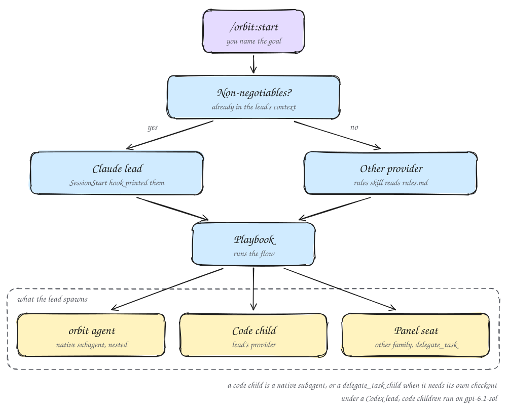

# Orbit in T3 Code

T3 Code runs orbit under a lead on any provider, such as Claude in Claude Code or Antigravity's Neon model. A lead in Claude Code gets orbit's hooks, agents and worktree guard natively. Any other lead maps Claude Code's tools to its own, as [A lead outside Claude Code](#a-lead-outside-claude-code) says. Other families also run as panel seats and the verifier. This record says how orbit loads, finds T3's tools, fills panel seats, spawns subagents and resolves paths. The [host adapter](../plugin/docs/harness/t3-code.md) holds the rules a lead follows. A session whose `other-family` row lists providers, or whose `verifier` row is `other-family` or `other-family, inherit`, also reads [t3-seats.md](../plugin/docs/harness/t3-seats.md). The [README](../README.md#install) holds the setup.

Since 0.79.0, orbit runs in T3 Code only. Every PR, CI, issue, worktree, wait, schedule and secret step maps to a T3 tool, as the adapter's Tools table says, and the plugin ships no scripts of its own for them. A T3 tool that a thread lacks takes the adapter's **When a tool is absent** path, which reports the gap instead of falling back to a shell CLI or a poll loop.

<picture>
  <source media="(prefers-color-scheme: dark)" srcset="diagrams/t3-lead-dark.svg">
  
</picture>

## How orbit loads

A lead in Claude Code loads orbit as a Claude Code plugin. Its SessionStart hooks print `plugin/rules.md` and `plugin/rules-shared.md` into the context, so Non-negotiables is there before the first reply. The diagram above shows this lead.

A lead outside Claude Code has no SessionStart hook. It gets the rules from the `rules` skill, as the next section says.

## A lead outside Claude Code

Before 0.70.0, Codex and Grok could lead a thread through a second adapter file, with rows per provider. That fork made orbit hard to maintain, so 0.70.0 removed it. Since 0.73.0, a lead on any provider runs orbit again, but no rule names a provider. Each rule keys on what the lead's tool list holds. `tests/provider-names.mjs` fails CI when a provider name appears in `plugin/` outside setup's ranking and the seat family words.

- **Rules.** The lead loads the `rules` skill before its first reply. The skill reads `plugin/rules.md` and `plugin/rules-shared.md`. It then takes the Models rows from `orbit models list --json`, else from the active profile of `~/.config/orbit/config.json`. When `Agent` or `Skill` is missing from the lead's tool list, the skill sends it to the adapter's Any lead section before its first reply.
- **Tools.** The adapter's [Any lead](../plugin/docs/harness/t3-code.md#any-lead) table maps each Claude Code tool to the lead's own equivalent. The lead reads a skill's `SKILL.md` by path in place of `Skill`, uses its own plan tool in place of `TodoWrite`, and asks a numbered question in place of `AskUserQuestion` when it has no question tool. A step the table does not cover takes the adapter's Tools table.
- **Children.** Children stay on the lead's provider unless their Models row names another. The lead uses its own subagent tool, and names the orbit agent file in the brief when that tool cannot select one. With no subagent tool, the lead does gitops's work itself and sends every other child to a same-provider `delegate_task`. A Models cell with a bare model name the lead's subagent tool does not take runs on the provider's default model. A seat on another family and a row that names another provider are the two ways a child leaves the lead's provider, as [Run a row on another provider](#run-a-row-on-another-provider) says.
- **Worktree.** Every lead passes the Worktree gate with `t3_worktree_handoff`, on a branch named `<type>/<slug>`. Its next turn runs in the new worktree.
- **Switching.** To switch the thread's provider mid-task, run `/orbit:pause-safely`, switch with `t3_thread_configure` or the T3 model picker, then run `/orbit:session-pickup`. The resume note goes to Claude Code's memory directory for the main checkout when the lead has no auto memory directory of its own, so a lead on either provider finds it. When the note has no `originSessionId` or is newer than the newest other transcript, pickup reads the note plus the prior thread with `t3_thread_read`.

A provider that loads skills from its own config, rather than from Claude Code's plugin folder, needs orbit's `plugin/skills` folder registered there. The `orbit` CLI does that: `orbit setup` and `orbit hosts sync` register `~/.config/orbit/current/plugin/skills` in Antigravity's `~/.gemini/config/skills.json`, and link it for Codex and `~/.agents`. `/orbit:setup` reads `orbit doctor --json` and offers `orbit hosts sync` when a registration drifted.

## Find T3's tools

T3 serves its tools as MCP tools, and a step probes each tool before its first call. A tool that is not present takes the adapter's **When a tool is absent** path, which names the gap in the reply and goes on.

The lead finds a tool in its tool list, or loads it with `ToolSearch`. It never probes with dummy arguments, because a dummy `delegate_task` starts a thread.

## Which children get a thread

The provider picks where a child runs, not the model. Only `delegate_task` opens a child thread under the lead.

- A child on the lead's provider runs native, nested in the lead's thread. That is an `Agent` call.
- A child on the lead's provider that needs its own checkout, or runs while the lead keeps working, is a same-provider `delegate_task` child, as [Give a child its own checkout](#give-a-child-its-own-checkout) says.
- A child on another provider is always a `delegate_task` child. A panel seat on another family and the verifier seat on another family run there, as [Fill a panel seat on another family](#fill-a-panel-seat-on-another-family) says. So does a child whose Models row names another provider, as [Run a row on another provider](#run-a-row-on-another-provider) says.
- Code writers, gitops and other native children move to another provider only when their Models row names it. A move loses their hooks, their `tools` limit and the worktree guard.
- Orbit never opens a top-level thread with `t3_thread_launch` unless the user asks for a new thread.

## Run a row on another provider

Any Models row's Model cell may hold one target, `<providerInstanceId>/<model>`, split at the first `/`. A `, <value> after <n> failed tries` value may be a target too. The `other-family` row keeps its ordered list. Here are the rows for an Antigravity lead on `gemini-pro-orchestrator-neon` that writes code on Opus, asks Fable for advice and writes docs on its own model:

```md
| `code` | | claudeAgent/claude-opus-5-5 | medium |
| `advisor` | | claudeAgent/claude-fable-5-2 | high |
| `docs` | Docs and prose | antigravity/gemini-4-neon | |
```

The adapter's [A cell that names a provider](../plugin/docs/harness/t3-code.md#a-cell-that-names-a-provider) resolves each spawn.

- A target on the lead's own provider runs on the lead's own subagent tool, with the target's model part as the model. A subagent tool that takes only short aliases gets the alias that is a token of the model id, so `claude-opus-5-5` runs as `opus`. A lead whose subagent tool cannot take the model sends the spawn to a same-provider `delegate_task` with that model.
- A target on another provider runs as a `delegate_task` child on it, when the lead runs in T3 with `delegate_task` and the provider passes the checks a seat's provider passes. A child that shares the checkout, such as the advisor or gitops, gets `isolation: "shared"`. A child that needs its own checkout runs as [Give a child its own checkout](#give-a-child-its-own-checkout) says, on the target's provider. Fix rounds for that row run on the same provider.
- From a child, without `delegate_task`, or when the provider fails a check, the spawn runs as if the cell were empty, and the reply says `<cell> unavailable: <reason>`.
- A `verifier` row with a target on another provider fills the verifier seat with that one entry, with no family check. When it is unavailable, the lead asks the user before a native verifier runs, or holds the PR, as for a list whose every entry failed.

A Claude child of a non-Claude lead gains orbit's hooks and the worktree guard, because it runs in Claude Code. A row that sends gitops or another native agent away from Claude Code loses the commit-trailer hook, the `tools` limit and the worktree guard. Writing the row accepts that loss. [pstack-differences.md](pstack-differences.md#model-per-role) records why.

## Fill a panel seat on another family

A review panel fills one seat on a model family other than the session's.

- The lead calls `orchestrator_capabilities` once per thread and reuses the result, and calls it again only after an error or a user-named provider change, or with `search` for a model the Models table names.
- The `other-family` row comes from the project's AGENTS.md, else from Orbit's [user-wide configuration](cli.md). The roster is the list of providers in its Model cell.
- An empty cell runs the skill's own seat, and the reply says that no seat on another family is configured. `inherit` keeps the session-family seat.
- A list tries at most three listed providers outside the session's family, in list order, and never a provider the list leaves out.
- An explicit model pick is checked with `search` before it is called unavailable.
- An unavailable entry goes in the reply with its reason, whether it failed a check or its child failed.
- The seat runs through `delegate_task`, reads only, and its child thread is settled when it returns.
- Seats that write code never take a roster seat. They run on the lead's provider, unless their Models row names another.

Orbit assumes no provider beyond the lead's own. Each seat on another family comes from a provider the user listed, checked at run time.

## Provider selection

The `other-family` Model cell resolves to one of four outcomes. The adapter's [t3-seats.md](../plugin/docs/harness/t3-seats.md) holds them as one table.

- An empty cell, or no row, runs the skill's session-family seat. The reply says that no seat on another family is configured and that `/orbit:setup` lists providers.
- `inherit` runs the session-family seat, with no line.
- A list gives at most three candidates, one per provider, in list order. An entry is a candidate when its provider is outside the session's family, is enabled, can run a cross-provider child task, lists models and offers the parent's runtime mode for a seat that runs commands. Its model must also pass the family check. The lead tries the candidates in order for one seat. They are fallbacks, not more reviewers.
- When every candidate fails at a check or after its spawn, the seat is skipped, and the reply says `Skipped <skill>'s seat on another family: every listed entry failed.` A list that ends with `inherit` runs the session-family seat instead. The verifier never skips. It runs native only when the `verifier` row's Model is `other-family, inherit`, which setup writes after the user's yes. Otherwise the lead asks the user before a native verifier runs, or holds the PR when no user can answer. A trailing `inherit` on the `other-family` row covers panel seats, not the verifier.

The family check reads the model, not only the provider. A provider's `driverKind` does not name the family of every model it serves, and an aggregator can serve the session's own family. A model is of the session's family when any token of its `id` matches the session's family word or that family's vendor, `anthropic`, `openai`, `google` or `xai`. That word comes from `inheritedModel`, not from each model the session's provider lists, because an aggregator lead lists models of several families. When `inheritedModel` is an alias such as `opus`, the word comes from the session provider's model whose `id` holds the alias. When neither gives a word, the family is unknown, and every seat says `family unverified`. A model named `auto` or `default` is opaque, so its seat says `family unverified`.

`/orbit:setup` recommends the first three enabled providers, ranked Codex, Muse, Gemini, then Grok. A seat counts its three candidates after its own checks, so an entry after the third still runs when an earlier entry fails them. Setup names such an entry with that condition and accepts the list.

<picture>
  <source media="(prefers-color-scheme: dark)" srcset="diagrams/provider-selection-dark.svg">
  
</picture>

## Give a child its own checkout

T3 sends a separate checkout and a background agent to `delegate_task`, never to an `Agent` with `isolation: "worktree"` or a background `Agent`. The adapter's Where a child runs table picks how each child runs, by what the child needs.

- A read-only or shared-checkout child stays a foreground `Agent` with no worktree. Examples are the `how` explainer, the advisor, judges on the session's family, audit and verify lanes, swarm workers that only read, gitops and serial delegates. A verify lane reads the head SHA from a `git archive -o` export.
- A parallel delegate, an arena runner, an interrogate adversary, a swarm worker that writes and the native verifier each run as a same-provider `delegate_task` child, with `isolation: "worktree"` and `mode: "async"`.
- An autopilot owner's build round runs the same way, so the root keeps its tick and starts the next owner as one finishes. The owner pushes, opens its PR, reads its state once with `pull_request_read` and returns. The root babysits the PR. Each later round of the owner, a fix, a rebase or the merge, runs in the root's thread as a foreground `Agent` in the owner's worktree, which outlives the child.

The lead commits what the child needs first, because T3 copies no uncommitted edits into the child's checkout. T3 starts that checkout at HEAD of the lead thread's bound checkout, else of the project root, which can lag the task branch. So the brief names the start SHA, and the child resets its own branch there. Before that, it checks that its checkout is neither the lead's nor the project root, and stops if it is, so a child that got no worktree never moves your branch. The child commits its unit in its own worktree and reports its path, branch and commit SHA. On the completion wake, the lead checks that the commit descends from the start SHA, reviews `git show <sha>`, gitops cherry-picks the commit onto the task branch, and the lead settles the child and removes any worktree that remains. A child starts no child thread, so its own parallel units run one at a time. Each such child adds one thread to the sidebar. [pstack-differences.md](pstack-differences.md#own-checkout-children) records the T3 rules and the prototype behind this.

## Resolve paths

- `plugin/rules.md` writes paths as `<orbit-plugin>`. The SessionStart hooks rewrite that token to the plugin folder in `rules.md` and `rules-shared.md`, so a lead in Claude Code sees full paths. A lead without the hooks reads both files through the `rules` skill, which names `<orbit-plugin>` as the folder two levels above the skill's base directory.
- Skill bodies use paths relative to their own folder, because Grok leaves `${CLAUDE_PLUGIN_ROOT}` unexpanded and names each skill's base directory.
- Some skills, such as `playbook` and `worktree-cleanup`, name `${CLAUDE_SKILL_DIR}`, which Claude Code expands to the skill's own base directory.
- `poteto-agent` and `gitops` keep `${CLAUDE_PLUGIN_ROOT}`. Claude Code and Grok both expand it in agent bodies. When another provider leaves it unexpanded, gitops uses the plugin folder its brief names, and with none it reports that and stops.

## What is verified

Each row is graded from tool calls by `tests/t3/grade.mjs`. [trails/live-matrix.tsv](trails/live-matrix.tsv) holds one row per scenario and lead, with each check's verdict, first-turn input tokens and wall time. A T3 row ran through `tests/t3/lane.mjs`, with orbit loaded from the SHA it names.

| Lead | Result |
| --- | --- |
| Claude lead in T3, claude-opus-5-5 | 15 of 16 current scenarios PASS at `34fdaae`, 1 run each, 2026-11-17. They are `probe`, `gitops-native`, `foreground`, `verifier-seat`, `review-seat`, `seat-listed`, `seat-empty`, `seat-all-fail`, `verifier-all-fail`, `watch-pr-wait`, `babysit-wait`, `schedule-loop`, `schedule-only`, `parallel-units` and `autopilot-owners`. `child-base` has no recorded run yet. Rerun on 2026-11-17, `verifier-all-fail` PASS at `cfc882d` and `parallel-units` at `083c25e`. Read by hand, the `verifier-all-fail` lead now sends `cursor unavailable: <reason>` and `muse unavailable: <reason>` on their own lines with `send_to_user` before its question ([#72](https://github.com/aayushbtw/orbit/issues/72)). In `parallel-units` the lead passes `medium` to both code delegates ([#71](https://github.com/aayushbtw/orbit/issues/71)). |
| Claude lead, headless | 1 run at `34fdaae`, 2026-11-17, of the `parallel-units` prompt outside T3. The lead ran both units as `Agent` children with `isolation: "worktree"`, and gitops cherry-picked both commits. The children committed their own units, because the Delegate gate's "gitops commits it there" step meets Claude Code's worktree guard ([#70](https://github.com/aayushbtw/orbit/issues/70)). The gate now says that path for every host. Not rerun headless after the change. |
| Antigravity lead in T3, gemini-4-neon | 1 run of `parallel-units` on 2026-11-23 with `--installed`, orbit 0.74.0 at `a48fe38`, and orbit's `plugin/skills` folder registered in `~/.gemini/config/skills.json`. The lane finished with `status: completed` and `wake: arrived` across 2 wakes. The lead discovered orbit's skills from `~/.gemini/config/skills.json`, ran the Plan gate, and started two parallel `delegate_task` worktree children on `gemini-4-neon` at `thought_level` `medium`. It cherry-picked both commits (`f670014` and `a4157c9`), passed all 8 `node --test` tests, and settled and removed both child worktrees and branches. Native subagent approval prompts timed out after 60s, so the lead ran gitops cherry-picks and comment checks directly. Graded on outcomes only, because `tests/t3/lane.mjs` reads only Claude session transcripts. |

No lane covers the thread-read row, the proof table's `html_preview`, the sudo flow, the Probe retry, a child retry, `task_cancel`, a later owner round, an arena, a swarm, or the verifier as a child in its own checkout. Leads on other providers were removed in 0.70.0 and came back in 0.73.0. `tests/t3/lane.mjs` accepts such a lead and grades it on outcomes only, because the grader reads only a Claude session transcript. The Antigravity row above is the first such lane since 0.73.0. The matrix file keeps the rows from before 0.70.0 as history.
